# Manual de usuario del portal del cliente — RentaDeAutos

Acceso para la demostración: https://srv01.tailb2f071.ts.net/login.html

**Origen:** S4-12. Actualización: S5-08.
**Tipo:** Manual de usuario del portal y aprobación por el personal.
**Base revisada:** commit `3b4380d062de6154ad1f71c6ceb9d3faadfcf883`.
**Fecha de revisión documental:** 6 de noviembre de 2026.

La revisión se realizó sobre el código y la documentación de esa versión.
La correspondencia con el servidor se registra por separado en
[la verificación S5-08](s5-08-verificacion-y-ensayo.md).

## 1. Introducción

El portal del cliente de RentaDeAutos permite consultar el catálogo de vehículos, revisar sus características y tarifas, solicitar reservaciones y consultar información relacionada con las rentas. También incluye apartados para revisar reportes de actividad y consultar respuestas a preguntas frecuentes.

Este manual describe el uso de las opciones visibles en el portal. La disponibilidad de los datos y el resultado de las operaciones dependen de que la aplicación y sus servicios estén funcionando correctamente.

## 2. Acceso al portal

### 2.1 Inicio de sesión de clientes y personal

1. Abrir `login.html` desde la dirección de la aplicación que proporcione el equipo.
2. Escribir el correo y la contraseña. El botón del ojo permite mostrar u ocultar la contraseña.
3. Seleccionar **INGRESAR**.
4. Una cuenta de cliente aprobada y activa entra al portal; una cuenta activa de
   personal entra al panel administrativo.
5. Si la sesión venció, iniciar sesión de nuevo antes de continuar.

Con credenciales incorrectas se muestra un mensaje genérico. Una cuenta pendiente
o rechazada no puede entrar. Si su contraseña es correcta, se informa el estado
de la solicitud. Si una cuenta aprobada se desactiva posteriormente, también pierde
el acceso. Contactar al personal si se requiere revisar el estado de la cuenta.

El personal no crea sus cuentas desde el registro público; utiliza la cuenta que
le asigna la administración. No hay verificación por correo ni recuperación
automática de contraseña mediante email en este alcance.

### 2.2 Registro de una cuenta de cliente

1. Desde el login, abrir la opción de registro.
2. Capturar nombre, apellidos, correo electrónico, teléfono, número de licencia,
   fecha de vencimiento y contraseña. La dirección es opcional.
3. Usar un correo con formato válido y una licencia cuyo vencimiento sea posterior
   al día actual. La contraseña admite entre 6 y 72 caracteres y no más de
   72 bytes UTF-8; algunos caracteres acentuados o emojis ocupan varios bytes.
4. Revisar los avisos del formulario y seleccionar **REGISTRARSE**.
5. Si el correo o la licencia ya están registrados, corregir los datos o consultar
   al personal. No enviar repetidamente la solicitud.
6. Al finalizar, el formulario muestra **“Tu cuenta quedó pendiente de aprobación”**.
   El registro no inicia una sesión y todavía no permite entrar al portal.
7. Esperar la revisión del personal. Después de ser aprobada, entrar desde el login
   con las mismas credenciales.

La autorización la puede realizar un administrador, agente o supervisor.
Una cuenta rechazada permanece inhabilitada. Los datos de cuentas anteriores y
altas de mostrador conservan el comportamiento previo.

### 2.2.1 Aprobar o rechazar cuentas desde el panel

Procedimiento para **ADMINISTRADOR, AGENTE y SUPERVISOR**:

1. Iniciar sesión como personal y abrir **Clientes pendientes**.
2. Identificar al solicitante por nombre, correo y licencia. Revisar los datos de
   contacto y el aviso de vigencia de licencia.
3. Para autorizar, seleccionar **Aprobar** y confirmar la acción cuando la interfaz
   lo solicite. La cuenta queda **APROBADO**, activa, y puede iniciar sesión.
4. Para denegar, seleccionar **Rechazar**, capturar un motivo opcional de hasta
   255 caracteres y confirmar la acción. Queda **RECHAZADO** e inactiva.
5. Leer el resultado, actualizar la vista y comprobar que la cuenta ya no aparezca
   como pendiente. El sistema registra la revisión en auditoría.

Si otra persona ya revisó la cuenta, el sistema puede mostrar un conflicto; actualizar
la lista antes de continuar. Una cuenta pendiente o rechazada no se habilita con
el botón de activación normal de **Clientes**. Este flujo no permite revisar de nuevo
una cuenta que ya dejó de estar pendiente.

El auditor y el cliente no están autorizados para consultar ni ejecutar estas
acciones. En caso de acceso denegado, no utilizar las credenciales de otra persona.

| Estado de aprobación | Activa | Acceso al portal |
|---|---|---|
| PENDIENTE | No | No |
| APROBADO | Sí | Sí |
| RECHAZADO | No | No |
| APROBADO y desactivada posteriormente | No | No |

### 2.3 Cierre de sesión

1. Localizar el icono de salida en la parte superior derecha del portal.
2. Seleccionarlo para cerrar la sesión.
3. Comprobar que el sistema regrese a la pantalla de acceso o a la página pública correspondiente.

Se recomienda cerrar sesión al terminar, especialmente cuando se utiliza un equipo compartido.

## 3. Navegación principal

En el menú lateral del portal se muestran las siguientes secciones:

- **Inicio:** acceso a la página principal del portal.
- **Catálogo:** consulta de los vehículos disponibles en el sistema.
- **Mis reservaciones:** consulta y administración de las reservaciones del cliente.
- **Mis rentas:** consulta de la información de rentas asociadas con la cuenta.
- **Reportes:** resumen de actividad e historial de operaciones del periodo.
- **Ayuda:** preguntas frecuentes sobre el portal y las rentas.

En la parte superior también se encuentra un campo de búsqueda con el texto **Buscar vehículos...**, además de la información de la cuenta y la opción para cerrar sesión.

## 4. Consultar y filtrar el catálogo de vehículos

La sección **Catálogo** muestra tarjetas con información de los vehículos, como nombre o modelo, categoría y tarifa por día. Cada tarjeta incluye la opción **Ver detalles**.

### 4.1 Consultar el catálogo

1. Seleccionar **Catálogo** en el menú lateral.
2. Revisar los vehículos mostrados y su tarifa por día.
3. Consultar la categoría indicada en cada tarjeta.
4. Seleccionar **Ver detalles** en el vehículo de interés para abrir su información.

### 4.2 Filtrar por categoría y precio

En el área de búsqueda del catálogo están disponibles los filtros **Categoría** y **Precio por día**.

1. Abrir el selector **Categoría**.
2. Elegir una categoría, por ejemplo **Todas**, **Económico**, **Lujo**, **Pickup** o **SUV**, según las opciones que aparezcan.
3. Abrir el selector **Precio por día**.
4. Elegir el rango de precio deseado. Las opciones mostradas en la interfaz incluyen **Todos**, **Hasta $600**, **$601 a $900**, **$901 a $1,200** y **Más de $1,200**.
5. Seleccionar **Buscar**.
6. Revisar los vehículos que coincidan con los criterios.

Los rangos y las categorías indicados corresponden a las opciones visibles en la interfaz y podrían cambiar con futuras actualizaciones.

También se puede utilizar el campo superior **Buscar vehículos...** si la búsqueda por texto está habilitada en la versión disponible.

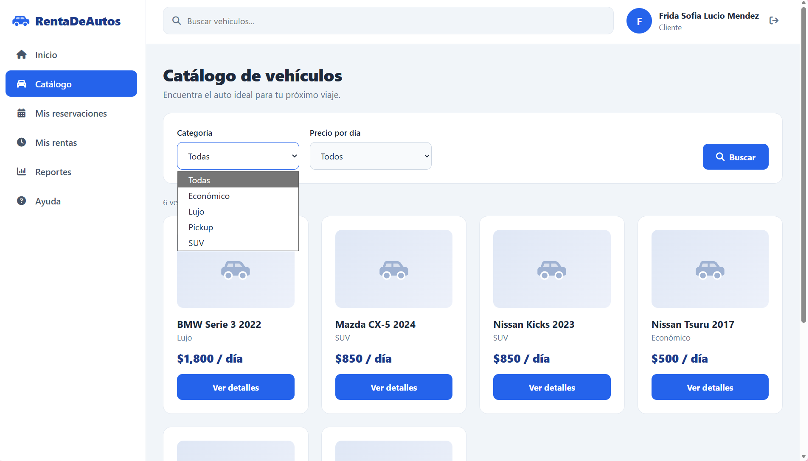

## 5. Consultar los detalles de un vehículo

1. Desde el catálogo, seleccionar **Ver detalles** en la tarjeta del vehículo.
2. Revisar el nombre, la categoría, el estado de disponibilidad, la descripción y la tarifa por día.
3. Si se desea continuar, elegir las fechas de inicio y fin en los campos correspondientes.
4. Revisar la duración y el total estimado que presenta el sistema.
5. Seleccionar **Reservar ahora** para continuar con el proceso de reservación.

La disponibilidad para las fechas seleccionadas y el costo final deben confirmarse durante el proceso de reservación. El precio mostrado en esta etapa es estimado y puede no representar el importe final de la operación.

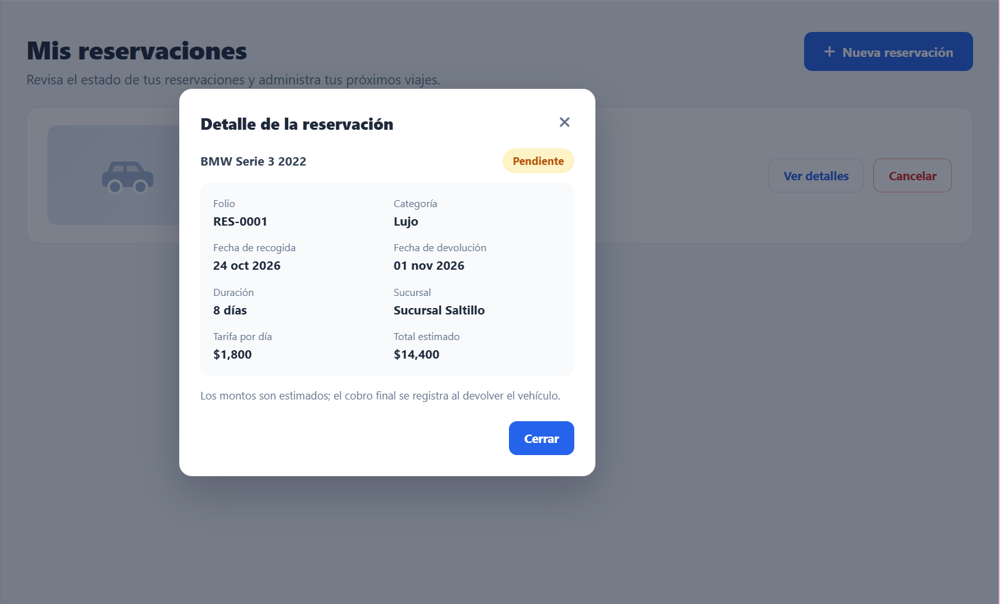

## 6. Realizar una reservación

El portal presenta el proceso de reservación en cuatro etapas: **Selección**, **Datos**, **Confirmación** y **Resultado**.

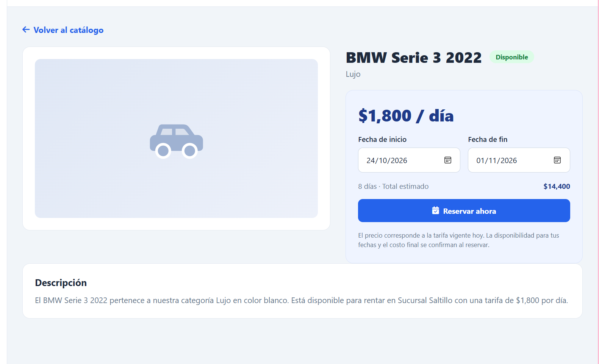

### 6.1 Selección del vehículo

1. Abrir el catálogo y elegir el vehículo.
2. Revisar su categoría, tarifa por día y sucursal.
3. Seleccionar **Continuar** para pasar a los datos de la reservación, o **Cambiar vehículo** si se desea elegir otro.

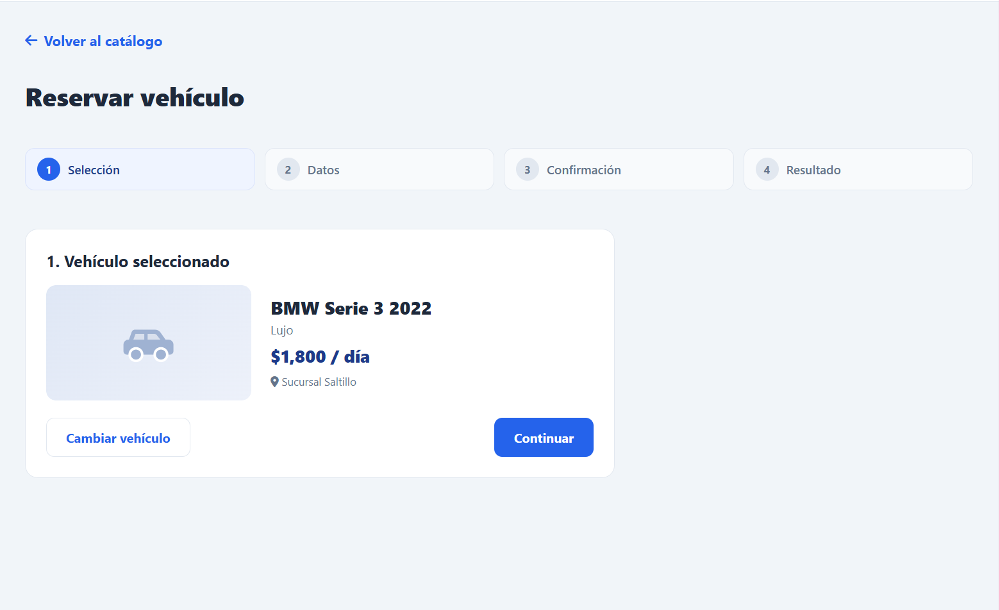

### 6.2 Captura de datos

1. Revisar la sucursal indicada para la recogida y devolución.
2. Seleccionar la **Fecha de inicio**.
3. Seleccionar la **Fecha de fin**, posterior al inicio. Para una reserva nueva, elegir un inicio futuro.
4. Agregar observaciones si se considera necesario; el campo **Observaciones** aparece como opcional.
5. Revisar la duración y el total estimado.
6. Seleccionar **Continuar**.

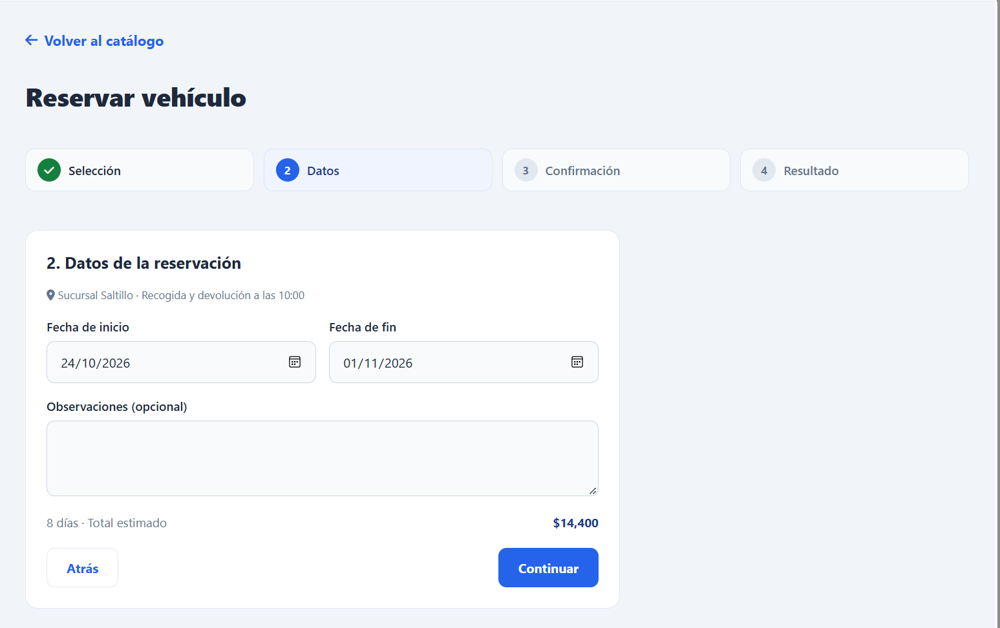

### 6.3 Confirmación

1. Revisar el resumen de la reservación, que muestra el vehículo, la sucursal, las fechas y horas, la duración, la tarifa por día y el total estimado.
2. Leer el aviso que indica que el importe es estimado y que el cobro se registra al devolver el vehículo.
3. Marcar la casilla de aceptación de los términos de la reservación.
4. Seleccionar **Confirmar reservación**.

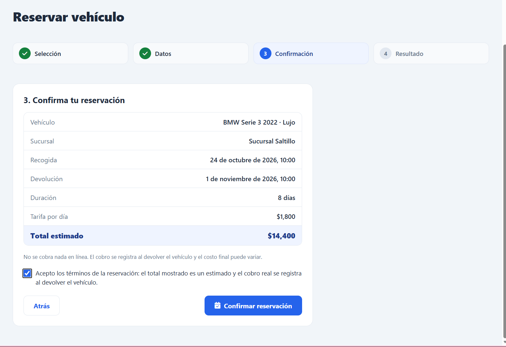

### 6.4 Resultado

Después de enviar la reservación, revisar el resultado que presenta el sistema. La pantalla de resultado puede mostrar el folio, el estado, el vehículo, la sucursal, las fechas y el total estimado.

La interfaz indica que una reservación registrada puede quedar **Pendiente de confirmación por parte del personal**. Por lo tanto, registrar una reservación no significa necesariamente que ya esté confirmada.

Se recomienda guardar o anotar el folio para facilitar la consulta posterior.

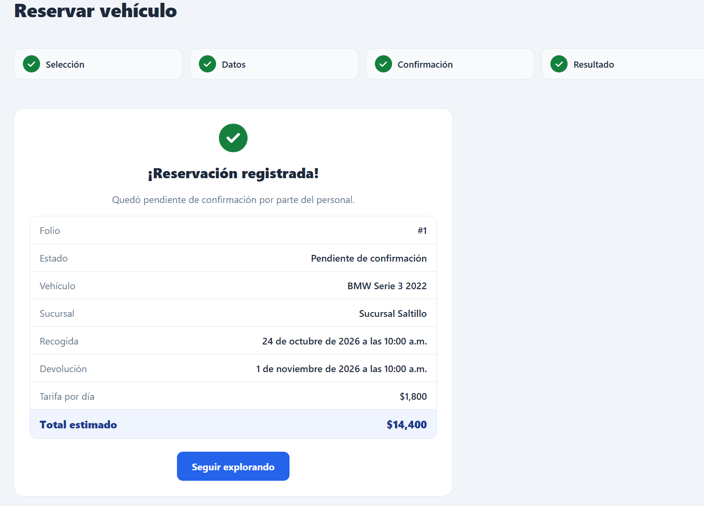

### 6.5 Consideraciones sobre el precio

- El total que muestra el sistema es un estimado.
- La tarifa por día se utiliza para calcular el importe estimado del periodo.
- La interfaz indica que no se realiza un cobro en línea durante la confirmación de la reservación.
- El cobro final se registra al devolver el vehículo y el importe final puede variar.

## 7. Consultar y cancelar reservaciones

La sección **Mis reservaciones** permite revisar las reservaciones de la cuenta. Cada registro puede mostrar el vehículo, la categoría, el folio, el estado, las fechas, la sucursal y el importe estimado.

### 7.1 Consultar una reservación

1. Seleccionar **Mis reservaciones** en el menú lateral.
2. Localizar la reservación que se desea revisar.
3. Consultar el estado que aparece junto al vehículo.
4. Seleccionar **Ver detalles** para abrir el resumen de la reservación.
5. Revisar el folio, la categoría, la fecha de recogida, la fecha de devolución, la duración, la sucursal, la tarifa por día y el total estimado.
6. Seleccionar **Cerrar** o el icono de cierre para volver a la lista.

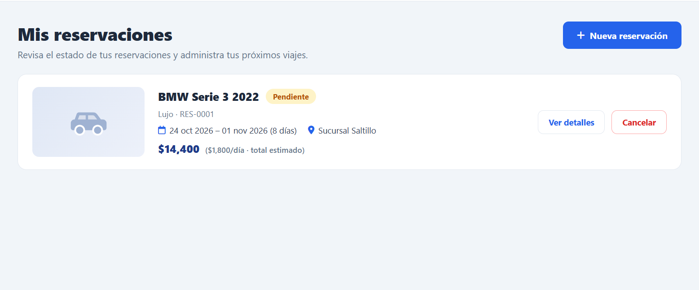

### 7.2 Cancelar una reservación

1. Abrir **Mis reservaciones**.
2. Localizar la reservación que se desea cancelar.
3. Comprobar cuidadosamente el vehículo y el folio.
4. Seleccionar **Cancelar**.
5. Leer el mensaje de confirmación.
6. Si se desea continuar, seleccionar **Sí, cancelar reservación**. Si no se desea cancelar, seleccionar **Volver** o cerrar el cuadro de diálogo.
7. Revisar el resultado de la operación y el estado actualizado de la reservación.

El portal advierte que la cancelación libera la unidad apartada y que la acción no se puede deshacer. Por eso, se debe verificar la reservación antes de confirmar.

Solo se pueden cancelar reservaciones propias **PENDIENTE** o **CONFIRMADA**
cuya fecha de inicio aún sea futura. No se puede cancelar una reservación
EN_CURSO, FINALIZADA, CANCELADA o cuya fecha de inicio ya pasó.

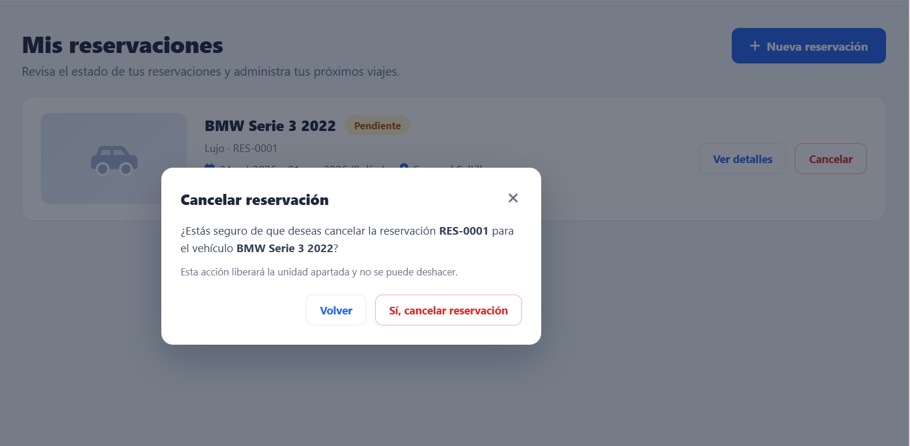

## 8. Consultar Mis rentas

Esta sección es de **solo lectura** y muestra únicamente rentas de la cuenta
actual que tienen una entrega registrada y están **EN_CURSO** o **FINALIZADA**.
Una reserva pendiente o confirmada todavía no aparece como renta.

1. Abrir **Mis rentas**.
2. Elegir **Todas**, **Renta activa** o **Finalizadas**.
3. Revisar vehículo, folio, fechas y estado.
4. Seleccionar **Ver detalles** para consultar la entrega, devolución prevista,
   devolución real cuando exista, tarifa y los importes disponibles.
5. Cerrar el detalle con **Cerrar** o el icono de cierre.

Una renta activa muestra el importe estimado. Cuando existe devolución, se muestra
el total final guardado. El cliente no registra entregas ni devoluciones desde
esta sección; esas operaciones las realiza el personal.

## 9. Consultar reportes e historial de operaciones

La sección **Reportes** presenta un resumen de la actividad del cliente y permite consultar el historial de rentas dentro de un periodo.

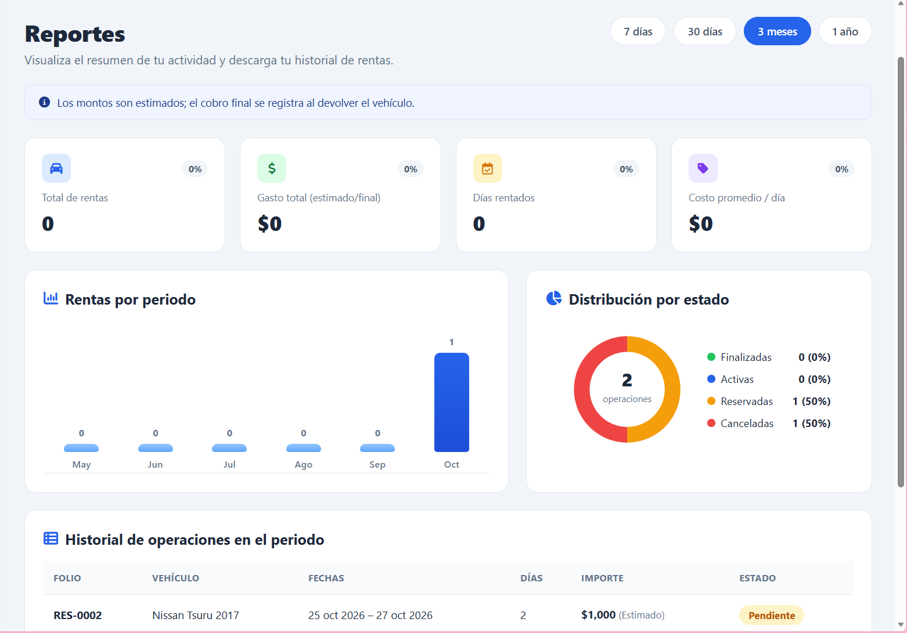

### 9.1 Seleccionar un periodo

En la parte superior se muestran opciones de periodo como **7 días**, **30 días**, **3 meses** y **1 año**.

1. Entrar a **Reportes**.
2. Seleccionar el periodo que se desea consultar.
3. Revisar los indicadores y gráficos que se actualicen para ese periodo.

### 9.2 Interpretar la información

Los indicadores visibles pueden incluir:

- **Total de rentas:** cantidad de operaciones contabilizadas.
- **Gasto total (estimado/final):** importe relacionado con las operaciones del periodo.
- **Días rentados:** cantidad de días contabilizados.
- **Costo promedio / día:** costo promedio diario calculado por el sistema.

La pantalla también presenta un gráfico de **Rentas por periodo**, una distribución por estado y una tabla titulada **Historial de operaciones en el periodo**. La tabla puede incluir folio, vehículo, fechas, días, importe y estado.

Los resultados dependen de los registros disponibles. Si no hay operaciones en el periodo seleccionado, algunos indicadores pueden aparecer en cero.

La interfaz incluye un aviso que recuerda que los importes son estimados y que el cobro final se registra al devolver el vehículo.

## 10. Centro de ayuda

La sección **Ayuda** contiene un **Centro de ayuda** con preguntas frecuentes sobre el portal y las rentas.

Entre las preguntas visibles se encuentran:

- ¿Cómo puedo hacer una reservación?
- ¿Qué documentos necesito para recoger el vehículo?
- ¿Puedo cancelar o modificar mi reservación?
- ¿Qué métodos de pago aceptan?
- ¿Qué incluye el precio de la renta?
- ¿Qué hago en caso de accidente o falla mecánica?

Para consultar una respuesta:

1. Seleccionar **Ayuda** en el menú lateral.
2. Localizar la pregunta relacionada con la duda.
3. Seleccionarla para desplegar su respuesta.
4. Leer las indicaciones y seguirlas cuando correspondan.

Las condiciones sobre documentos, pagos, cobertura, modificaciones y asistencia deben consultarse en las respuestas vigentes del portal o con el personal responsable. No se deben asumir condiciones que no estén especificadas por el servicio.

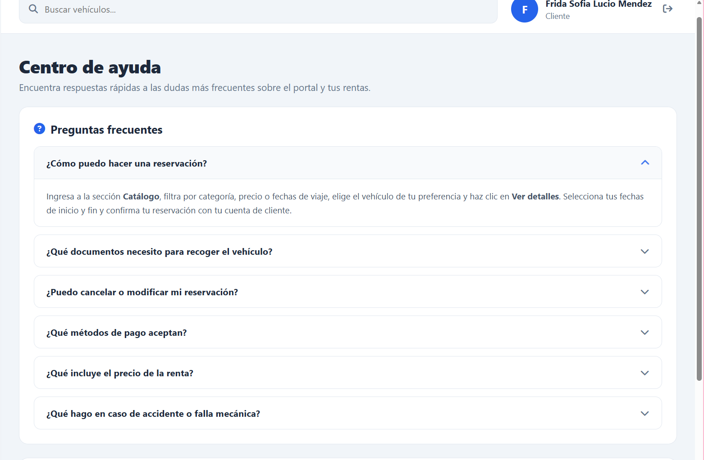

## 11. Errores comunes y recomendaciones

| Situación | Qué hacer |
|---|---|
| No se puede iniciar sesión. | Verificar credenciales, aprobación y que la cuenta siga activa. |
| Cuenta pendiente de aprobación. | Esperar la revisión del personal; el registro exitoso no concede acceso inmediato. |
| Cuenta rechazada. | Consultar al personal. La cuenta no puede entrar al portal. |
| Correo o licencia duplicados. | Revisar los datos y consultar al personal si ya existe una cuenta. |
| Vehículo ocupado en esas fechas. | Elegir otro vehículo o periodo; no se guarda una reserva traslapada. |
| El catálogo no muestra los resultados esperados. | Revisar los filtros de categoría y precio y seleccionar **Buscar** nuevamente. |
| No se encuentra un vehículo. | Probar otra categoría o rango de precio y revisar los criterios de búsqueda. |
| Las fechas no se aceptan. | Revisar las fechas de inicio y fin y los mensajes que muestre el sistema. |
| No se puede confirmar una reservación. | Revisar que los datos estén completos, que se haya aceptado el aviso de términos y que el sistema no muestre errores. |
| La reservación aparece pendiente. | Tener presente que la pantalla indica que puede requerir confirmación por parte del personal. Consultar su estado posteriormente. |
| No aparece una reservación en la lista. | Actualizar la sección y verificar que se haya completado el proceso y que se esté utilizando la cuenta correcta. |
| Se desea cancelar una reservación. | Revisar el folio y el vehículo antes de confirmar. La interfaz advierte que la cancelación no se puede deshacer. |
| Los reportes muestran valores en cero. | Revisar el periodo seleccionado y comprobar si existen operaciones registradas en ese intervalo. |
| La página no carga o muestra un error. | Actualizar la página y comprobar la conexión. Si el problema continúa, informar al responsable del sistema. |

### Recomendaciones generales

- Verificar el vehículo, las fechas y la sucursal antes de confirmar una reservación.
- Revisar el total estimado y las condiciones mostradas por el sistema.
- Guardar el folio de cada reservación.
- Comprobar el estado después de realizar una operación.
- No compartir las credenciales de acceso.
- Cerrar sesión al utilizar un dispositivo compartido.
- Evitar enviar repetidamente una operación si el sistema todavía está procesando la solicitud.
- Consultar el Centro de ayuda ante dudas sobre las condiciones del servicio.

## 12. Alcance y mantenimiento del manual

Este documento actualiza el manual de S4-12 para el flujo de S5-09. Conserva los
procedimientos del catálogo, reservaciones, reportes y ayuda. Las capturas
conservadas de S4-12 son referencias visuales; deben contrastarse con el despliegue
antes de sustituirlas por capturas nuevas. Se retiraron las capturas antiguas de
login y registro para no representar como vigente el acceso inmediato.

El sistema opera con Sucursal Saltillo y no cobra en línea al crear la reserva.
La aprobación de una **cuenta** y la confirmación de una **reservación** son pasos
distintos. Tras la confirmación del personal se registra la entrega, y después la
devolución con el costo final.

Documentos relacionados:

- [Guía de despliegue Ubuntu](s5-08-guia-despliegue-ubuntu.md).
- [Guion de demostración](s5-08-guion-demo.md).
- [Verificación de versión y acta de ensayo](s5-08-verificacion-y-ensayo.md).
