# Manual de usuario del portal del cliente — RentaDeAutos

**Tarea:** S4-12 — Documentar el portal y actualizar el manual de usuario  
**Sprint:** 4  
**Tipo de documento:** Manual de usuario  
**Ubicación sugerida en el repositorio:** `docs/manual-usuario-portal-cliente.md`

## 1. Introducción

El portal del cliente de RentaDeAutos permite consultar el catálogo de vehículos, revisar sus características y tarifas, solicitar reservaciones y consultar información relacionada con las rentas. También incluye apartados para revisar reportes de actividad y consultar respuestas a preguntas frecuentes.

Este manual describe el uso de las opciones visibles en el portal. La disponibilidad de los datos y el resultado de las operaciones dependen de que la aplicación y sus servicios estén funcionando correctamente.

## 2. Acceso al portal

### 2.1 Inicio de sesión

1. Abrir la página de inicio de sesión.
2. Escribir el correo electrónico en el campo **Correo Electrónico**.
3. Introducir la contraseña en el campo **Contraseña**.
4. Seleccionar **INGRESAR**.
5. Si las credenciales son válidas, el sistema permitirá acceder al portal correspondiente a la cuenta.

Si no se puede iniciar sesión, verificar que el correo y la contraseña estén escritos correctamente. Si el problema continúa, comprobar que el servicio de autenticación esté disponible o contactar al responsable del sistema.

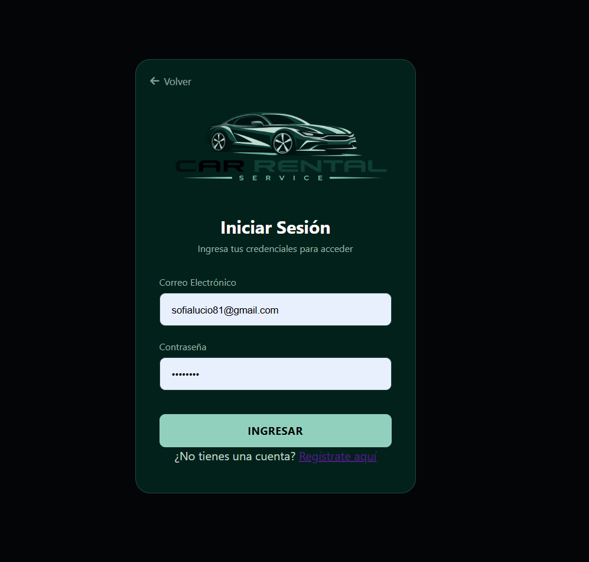

### 2.2 Registro de una cuenta

1. En la pantalla de inicio de sesión, seleccionar **Regístrate aquí**.
2. Completar los campos que solicite el formulario de registro.
3. Revisar que la información sea correcta.
4. Enviar el formulario y leer el mensaje que muestre el sistema.
5. Si el registro se completa correctamente, regresar al inicio de sesión e ingresar con las credenciales registradas.

Los campos exactos del formulario y las validaciones pueden variar según la versión desplegada del portal.

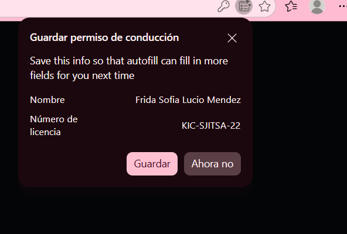

### 2.3 Cierre de sesión

1. Localizar el icono de salida en la parte superior derecha del portal.
2. Seleccionarlo para cerrar la sesión.
3. Comprobar que el sistema regrese a la pantalla de acceso o a la página pública correspondiente.

Se recomienda cerrar sesión al terminar, especialmente cuando se utiliza un equipo compartido.

## 3. Navegación principal

En el menú lateral del portal se muestran las siguientes secciones:

- **Inicio:** acceso a la página principal del portal.
- **Catálogo:** consulta de los vehículos disponibles en el sistema.
- **Mis reservaciones:** consulta y administración de las reservaciones del cliente.
- **Mis rentas:** consulta de la información de rentas asociadas con la cuenta.
- **Reportes:** resumen de actividad e historial de operaciones del periodo.
- **Ayuda:** preguntas frecuentes sobre el portal y las rentas.

En la parte superior también se encuentra un campo de búsqueda con el texto **Buscar vehículos...**, además de la información de la cuenta y la opción para cerrar sesión.

## 4. Consultar y filtrar el catálogo de vehículos

La sección **Catálogo** muestra tarjetas con información de los vehículos, como nombre o modelo, categoría y tarifa por día. Cada tarjeta incluye la opción **Ver detalles**.

### 4.1 Consultar el catálogo

1. Seleccionar **Catálogo** en el menú lateral.
2. Revisar los vehículos mostrados y su tarifa por día.
3. Consultar la categoría indicada en cada tarjeta.
4. Seleccionar **Ver detalles** en el vehículo de interés para abrir su información.

### 4.2 Filtrar por categoría y precio

En el área de búsqueda del catálogo están disponibles los filtros **Categoría** y **Precio por día**.

1. Abrir el selector **Categoría**.
2. Elegir una categoría, por ejemplo **Todas**, **Económico**, **Lujo**, **Pickup** o **SUV**, según las opciones que aparezcan.
3. Abrir el selector **Precio por día**.
4. Elegir el rango de precio deseado. Las opciones mostradas en la interfaz incluyen **Todos**, **Hasta $600**, **$601 a $900**, **$901 a $1,200** y **Más de $1,200**.
5. Seleccionar **Buscar**.
6. Revisar los vehículos que coincidan con los criterios.

Los rangos y las categorías indicados corresponden a las opciones visibles en la interfaz y podrían cambiar con futuras actualizaciones.

También se puede utilizar el campo superior **Buscar vehículos...** si la búsqueda por texto está habilitada en la versión disponible.

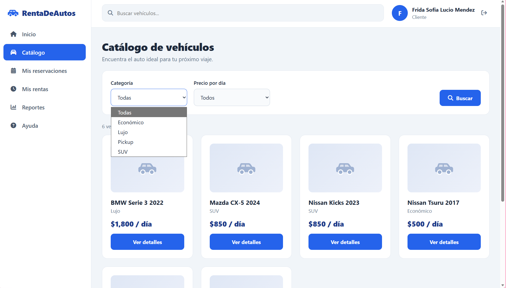

## 5. Consultar los detalles de un vehículo

1. Desde el catálogo, seleccionar **Ver detalles** en la tarjeta del vehículo.
2. Revisar el nombre, la categoría, el estado de disponibilidad, la descripción y la tarifa por día.
3. Si se desea continuar, elegir las fechas de inicio y fin en los campos correspondientes.
4. Revisar la duración y el total estimado que presenta el sistema.
5. Seleccionar **Reservar ahora** para continuar con el proceso de reservación.

La disponibilidad para las fechas seleccionadas y el costo final deben confirmarse durante el proceso de reservación. El precio mostrado en esta etapa es estimado y puede no representar el importe final de la operación.

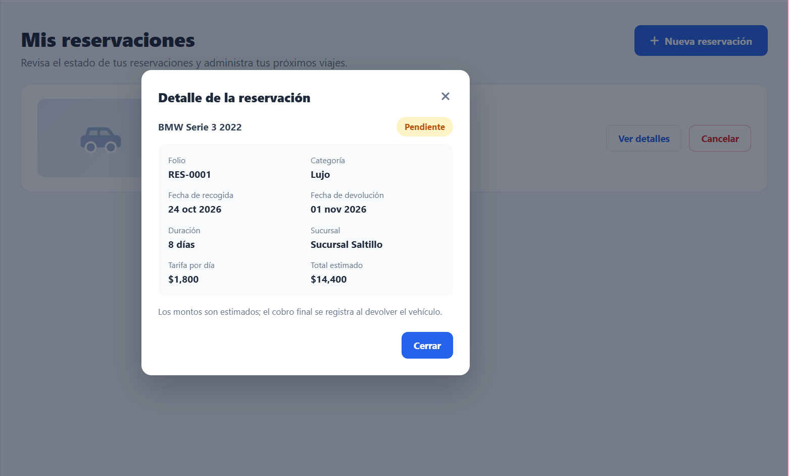

## 6. Realizar una reservación

El portal presenta el proceso de reservación en cuatro etapas: **Selección**, **Datos**, **Confirmación** y **Resultado**.

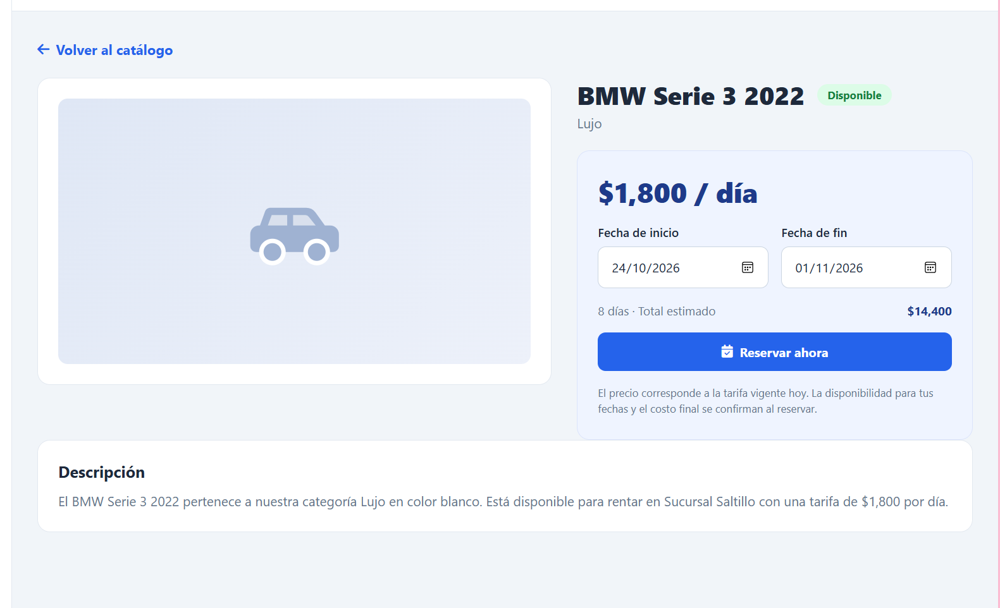

### 6.1 Selección del vehículo

1. Abrir el catálogo y elegir el vehículo.
2. Revisar su categoría, tarifa por día y sucursal.
3. Seleccionar **Continuar** para pasar a los datos de la reservación, o **Cambiar vehículo** si se desea elegir otro.

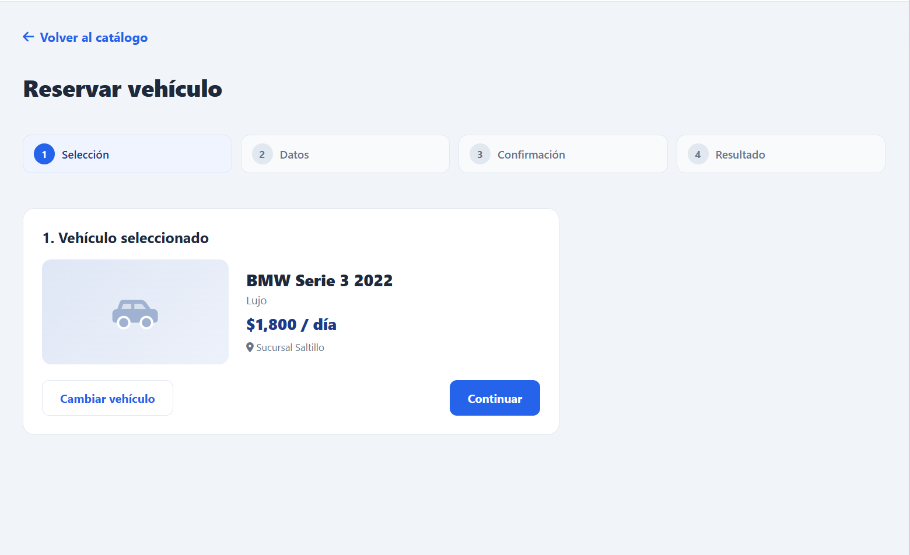

### 6.2 Captura de datos

1. Revisar la sucursal indicada para la recogida y devolución.
2. Seleccionar la **Fecha de inicio**.
3. Seleccionar la **Fecha de fin**.
4. Agregar observaciones si se considera necesario; el campo **Observaciones** aparece como opcional.
5. Revisar la duración y el total estimado.
6. Seleccionar **Continuar**.

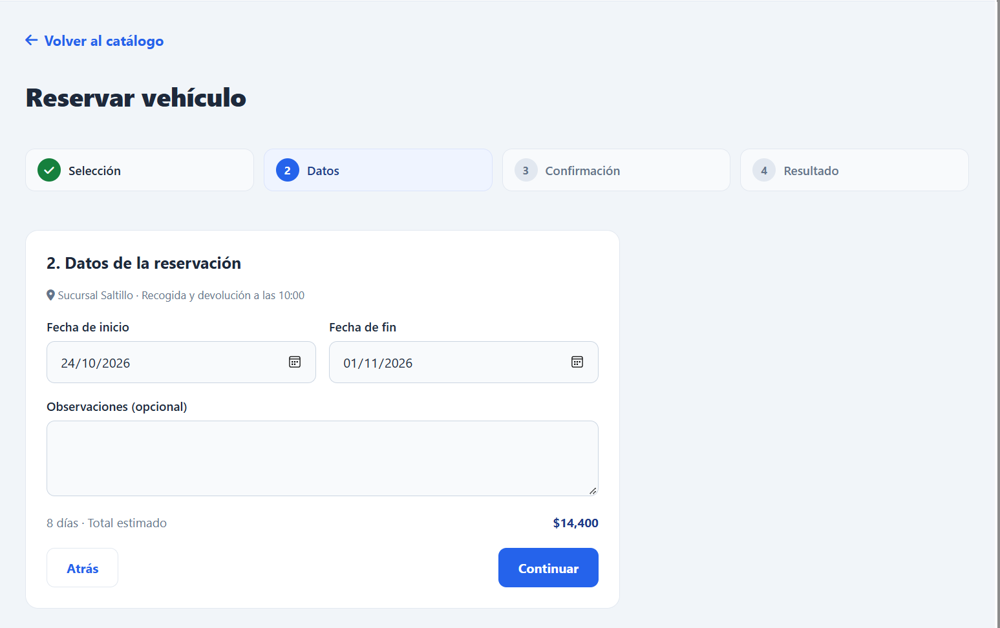

### 6.3 Confirmación

1. Revisar el resumen de la reservación, que muestra el vehículo, la sucursal, las fechas y horas, la duración, la tarifa por día y el total estimado.
2. Leer el aviso que indica que el importe es estimado y que el cobro se registra al devolver el vehículo.
3. Marcar la casilla de aceptación de los términos de la reservación.
4. Seleccionar **Confirmar reservación**.

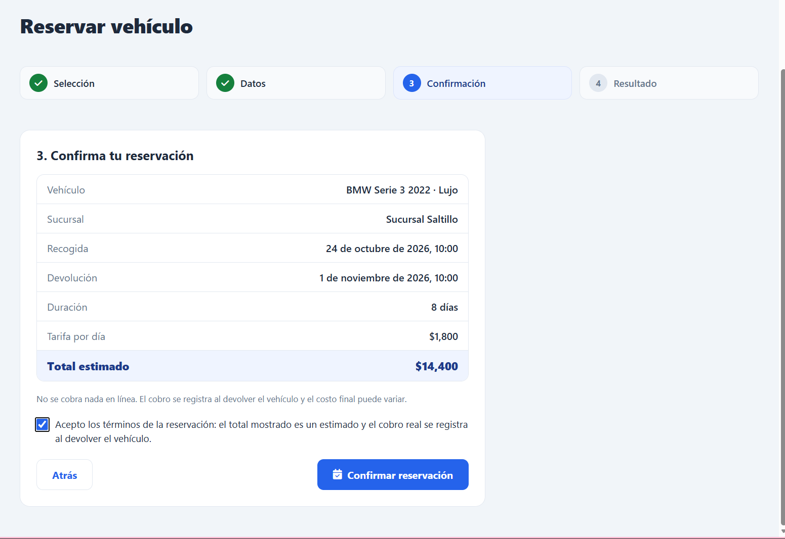

### 6.4 Resultado

Después de enviar la reservación, revisar el resultado que presenta el sistema. La pantalla de resultado puede mostrar el folio, el estado, el vehículo, la sucursal, las fechas y el total estimado.

La interfaz indica que una reservación registrada puede quedar **Pendiente de confirmación por parte del personal**. Por lo tanto, registrar una reservación no significa necesariamente que ya esté confirmada.

Se recomienda guardar o anotar el folio para facilitar la consulta posterior.

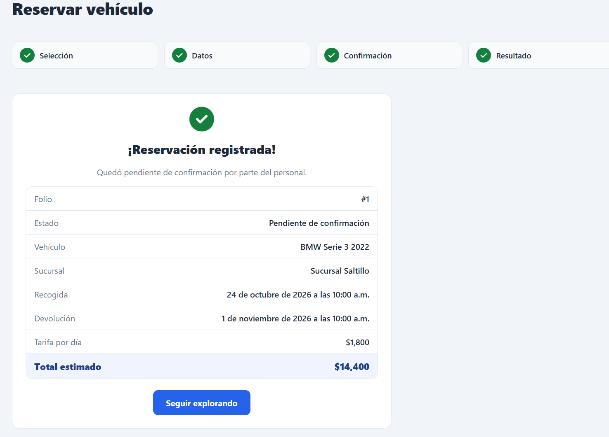

### 6.5 Consideraciones sobre el precio

- El total que muestra el sistema es un estimado.
- La tarifa por día se utiliza para calcular el importe estimado del periodo.
- La interfaz indica que no se realiza un cobro en línea durante la confirmación de la reservación.
- El cobro final se registra al devolver el vehículo y el importe final puede variar.

## 7. Consultar y cancelar reservaciones

La sección **Mis reservaciones** permite revisar las reservaciones de la cuenta. Cada registro puede mostrar el vehículo, la categoría, el folio, el estado, las fechas, la sucursal y el importe estimado.

### 7.1 Consultar una reservación

1. Seleccionar **Mis reservaciones** en el menú lateral.
2. Localizar la reservación que se desea revisar.
3. Consultar el estado que aparece junto al vehículo.
4. Seleccionar **Ver detalles** para abrir el resumen de la reservación.
5. Revisar el folio, la categoría, la fecha de recogida, la fecha de devolución, la duración, la sucursal, la tarifa por día y el total estimado.
6. Seleccionar **Cerrar** o el icono de cierre para volver a la lista.

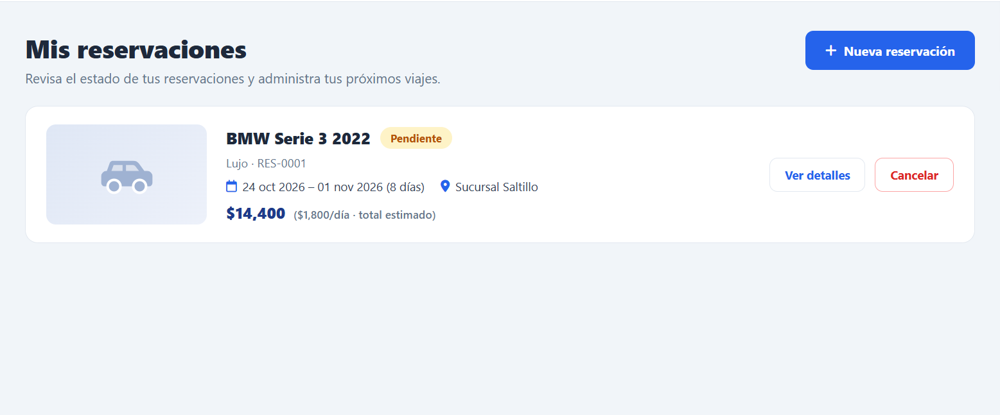

### 7.2 Cancelar una reservación

1. Abrir **Mis reservaciones**.
2. Localizar la reservación que se desea cancelar.
3. Comprobar cuidadosamente el vehículo y el folio.
4. Seleccionar **Cancelar**.
5. Leer el mensaje de confirmación.
6. Si se desea continuar, seleccionar **Sí, cancelar reservación**. Si no se desea cancelar, seleccionar **Volver** o cerrar el cuadro de diálogo.
7. Revisar el resultado de la operación y el estado actualizado de la reservación.

El portal advierte que la cancelación libera la unidad apartada y que la acción no se puede deshacer. Por eso, se debe verificar la reservación antes de confirmar.

La opción de cancelación puede depender del estado de la reservación y de las reglas del sistema.

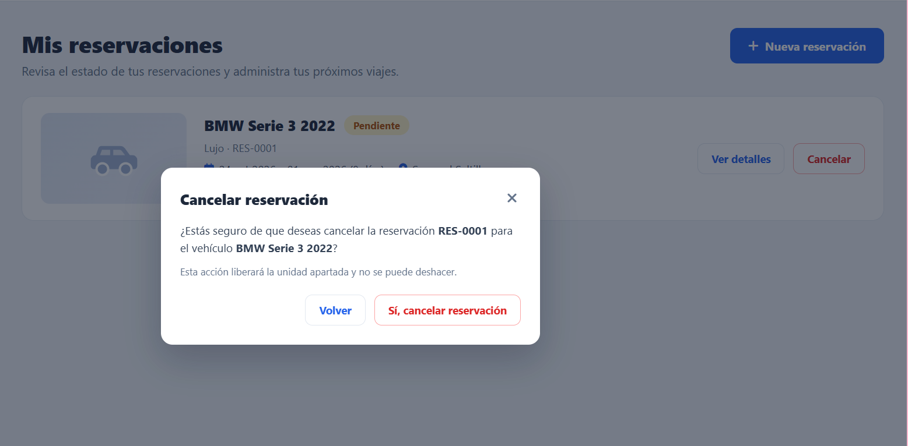

## 8. Consultar Mis rentas

La sección **Mis rentas** está destinada a consultar la información de las rentas asociadas con la cuenta del cliente.

1. Seleccionar **Mis rentas** en el menú lateral.
2. Revisar los registros que muestre el sistema.
3. Abrir los detalles disponibles, si la interfaz ofrece esa opción.
4. Comprobar la información y el estado que aparezcan en cada registro.

La información visible dependerá de las rentas registradas y de la versión de la aplicación. Una reservación pendiente no debe interpretarse automáticamente como una renta finalizada.

## 9. Consultar reportes e historial de operaciones

La sección **Reportes** presenta un resumen de la actividad del cliente y permite consultar el historial de rentas dentro de un periodo.

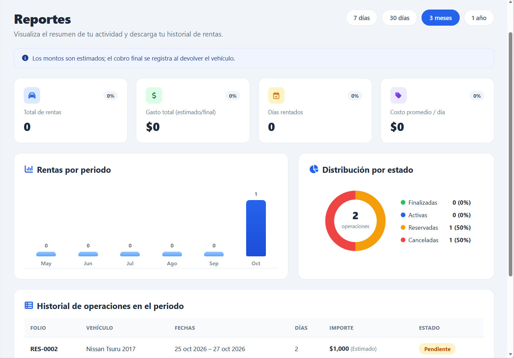

### 9.1 Seleccionar un periodo

En la parte superior se muestran opciones de periodo como **7 días**, **30 días**, **3 meses** y **1 año**.

1. Entrar a **Reportes**.
2. Seleccionar el periodo que se desea consultar.
3. Revisar los indicadores y gráficos que se actualicen para ese periodo.

### 9.2 Interpretar la información

Los indicadores visibles pueden incluir:

- **Total de rentas:** cantidad de operaciones contabilizadas.
- **Gasto total (estimado/final):** importe relacionado con las operaciones del periodo.
- **Días rentados:** cantidad de días contabilizados.
- **Costo promedio / día:** costo promedio diario calculado por el sistema.

La pantalla también presenta un gráfico de **Rentas por periodo**, una distribución por estado y una tabla titulada **Historial de operaciones en el periodo**. La tabla puede incluir folio, vehículo, fechas, días, importe y estado.

Los resultados dependen de los registros disponibles. Si no hay operaciones en el periodo seleccionado, algunos indicadores pueden aparecer en cero.

La interfaz incluye un aviso que recuerda que los importes son estimados y que el cobro final se registra al devolver el vehículo.

## 10. Centro de ayuda

La sección **Ayuda** contiene un **Centro de ayuda** con preguntas frecuentes sobre el portal y las rentas.

Entre las preguntas visibles se encuentran:

- ¿Cómo puedo hacer una reservación?
- ¿Qué documentos necesito para recoger el vehículo?
- ¿Puedo cancelar o modificar mi reservación?
- ¿Qué métodos de pago aceptan?
- ¿Qué incluye el precio de la renta?
- ¿Qué hago en caso de accidente o falla mecánica?

Para consultar una respuesta:

1. Seleccionar **Ayuda** en el menú lateral.
2. Localizar la pregunta relacionada con la duda.
3. Seleccionarla para desplegar su respuesta.
4. Leer las indicaciones y seguirlas cuando correspondan.

Las condiciones sobre documentos, pagos, cobertura, modificaciones y asistencia deben consultarse en las respuestas vigentes del portal o con el personal responsable. No se deben asumir condiciones que no estén especificadas por el servicio.

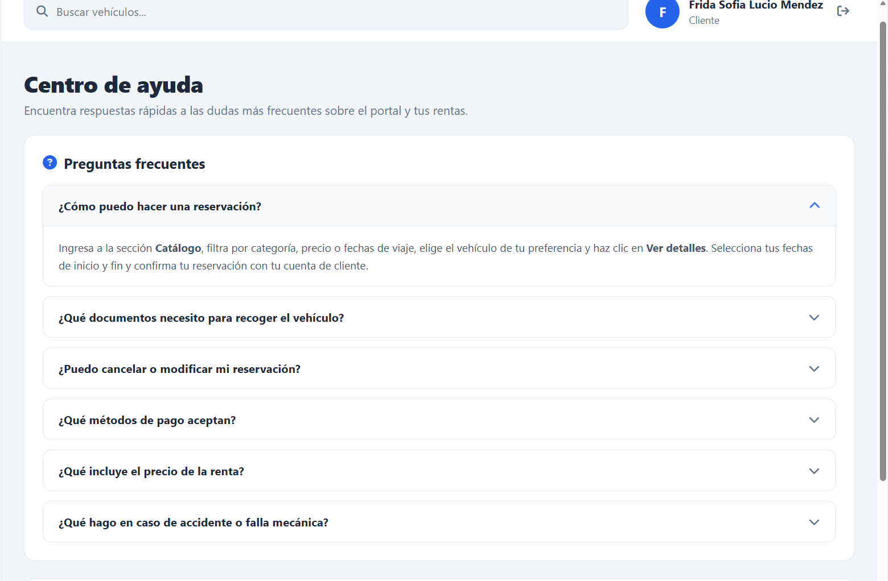

## 11. Errores comunes y recomendaciones

| Situación | Qué hacer |
|---|---|
| No se puede iniciar sesión. | Verificar el correo y la contraseña e intentar de nuevo. Si continúa, comprobar que el servicio de autenticación esté disponible. |
| El catálogo no muestra los resultados esperados. | Revisar los filtros de categoría y precio y seleccionar **Buscar** nuevamente. |
| No se encuentra un vehículo. | Probar otra categoría o rango de precio y revisar los criterios de búsqueda. |
| Las fechas no se aceptan. | Revisar las fechas de inicio y fin y los mensajes que muestre el sistema. |
| No se puede confirmar una reservación. | Revisar que los datos estén completos, que se haya aceptado el aviso de términos y que el sistema no muestre errores. |
| La reservación aparece pendiente. | Tener presente que la pantalla indica que puede requerir confirmación por parte del personal. Consultar su estado posteriormente. |
| No aparece una reservación en la lista. | Actualizar la sección y verificar que se haya completado el proceso y que se esté utilizando la cuenta correcta. |
| Se desea cancelar una reservación. | Revisar el folio y el vehículo antes de confirmar. La interfaz advierte que la cancelación no se puede deshacer. |
| Los reportes muestran valores en cero. | Revisar el periodo seleccionado y comprobar si existen operaciones registradas en ese intervalo. |
| La página no carga o muestra un error. | Actualizar la página y comprobar la conexión. Si el problema continúa, informar al responsable del sistema. |

### Recomendaciones generales

- Verificar el vehículo, las fechas y la sucursal antes de confirmar una reservación.
- Revisar el total estimado y las condiciones mostradas por el sistema.
- Guardar el folio de cada reservación.
- Comprobar el estado después de realizar una operación.
- No compartir las credenciales de acceso.
- Cerrar sesión al utilizar un dispositivo compartido.
- Evitar enviar repetidamente una operación si el sistema todavía está procesando la solicitud.
- Consultar el Centro de ayuda ante dudas sobre las condiciones del servicio.

## 12. Alcance y mantenimiento del manual

Este documento se basa en las opciones y los flujos identificados en las pantallas disponibles del portal del cliente. La documentación debe actualizarse cuando cambien los formularios, los estados, los mensajes, las reglas de negocio o la navegación.

Los procedimientos que dependan de servicios del backend deben comprobarse en un entorno funcional antes de considerarse verificados. Las capturas de pantalla pueden agregarse en una actualización posterior, cuando se pueda ejecutar la aplicación y confirmar cada flujo.

## 13. Conclusión

El portal de RentaDeAutos reúne las funciones principales para que el cliente consulte vehículos, filtre el catálogo, revise los detalles, solicite reservaciones, consulte sus operaciones y acceda al centro de ayuda. Este manual describe los pasos generales para utilizar esas opciones y destaca aspectos importantes como la confirmación pendiente y el carácter estimado de los importes.

Mantener esta documentación alineada con la aplicación facilita el uso del sistema y permite actualizar la guía conforme avance el desarrollo del proyecto.
